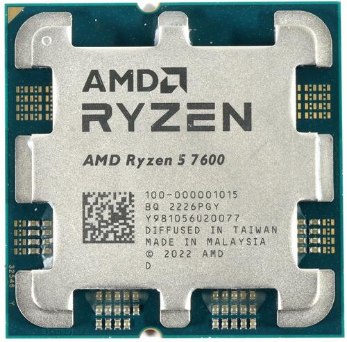
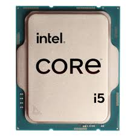
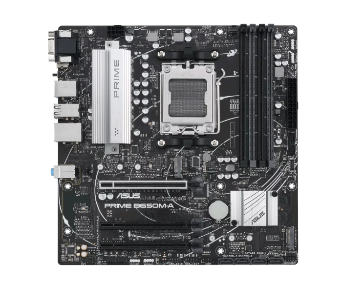
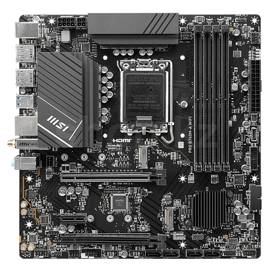
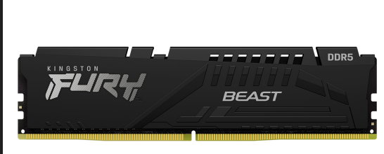
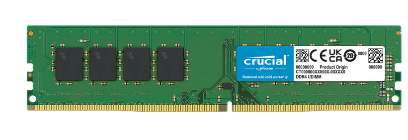
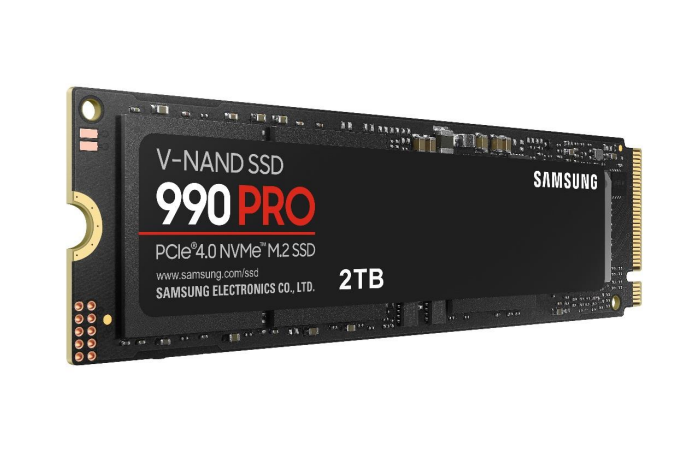
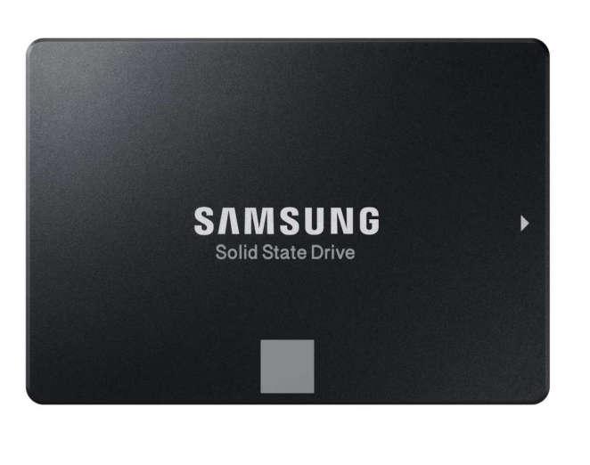
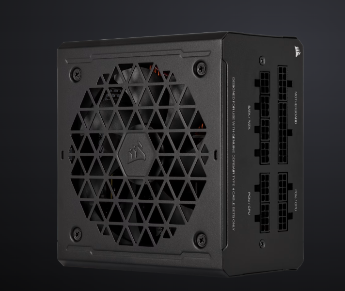
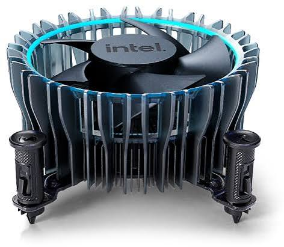

# Lab 3 — Teardown, and the same machine from the command line

Pair: Duisenbay Bauyrzhan + Maratov Anuar · Date: 11.8.2026

## Part 1 — Ten parts

### AMD Ryzen 5 7600
  
6-core/12-thread processor, up to 5.1 GHz, 38 MB cache, 65 W TDP (ships with the AMD Wraith Stealth stock cooler). Connects to an AM5 socket; memory controller supports DDR5. Limit: fits only AM5 motherboards; DDR4 memory is unsupported.  
Source: https://www.amd.com/en/products/processors/desktops/ryzen/7000-series/amd-ryzen-5-7600.html#product-specs

### Intel Core i5-13400
  
10-core/16-thread processor, up to 4.60 GHz, 20 MB cache, 65 W base power (ships with the Intel Laminar RM1 stock cooler). Connects to an LGA1700 socket; memory controller supports DDR4 and DDR5. Limit: fits only LGA1700 motherboards.  
Source: https://www.intel.com/content/www/us/en/products/sku/230495/intel-core-i513400-processor-20m-cache-up-to-4-60-ghz/specifications.html

### ASUS PRIME B650M-A
  
Micro-ATX motherboard, AMD B650 chipset. Connects to an AM5 processor, 4× DDR5 DIMM slots, 2× M.2 NVMe slots, and 4× SATA 6Gb/s ports. CPU support: AMD Ryzen 7000, 8000, and 9000 Series desktop processors (BIOS update required for 8000/9000 Series). Limit: supports only compatible AM5 Ryzen processors; DDR5 slots make DDR4 impossible.  
Source: https://www.asus.com/motherboards-components/motherboards/prime/prime-b650m-a/

### MSI PRO B760M-A WIFI DDR4
  
Micro-ATX motherboard, Intel B760 chipset, Wi-Fi. Connects to an LGA1700 processor, 4× DDR4 DIMM slots, 2× M.2 NVMe slots, and 4× SATA 6Gb/s ports. CPU support: 12th, 13th, and 14th Gen Intel Core, Pentium Gold, and Celeron processors (BIOS update required for 14th Gen). Limit: supports only compatible LGA1700 Intel processors; DDR4 slots make DDR5 impossible.  
Source: https://storage-asset.msi.com/datasheet/mb/global/PRO-B760M-A-WIFI-DDR4.pdf

### Kingston FURY Beast DDR5-5600, 16 GB
  
DDR5 UDIMM, 16 GB, 5600 MT/s, 288 pins. Connects to a desktop DDR5 slot, one per memory channel. Limit: fits only DDR5 boards; the notch makes DDR4 slots impossible.  
Source: https://www.kingston.com/datasheets/KF556C40BB-16.pdf

### Crucial DDR4-3200, 16 GB DIMM
  
DDR4 UDIMM, 16 GB, 3200 MT/s, 288 pins. Connects to a desktop DDR4 slot, one per memory channel. Limit: fits only DDR4 boards; the notch makes DDR5 slots impossible.  
Source: https://eu.crucial.com/memory/eol_ddr4/ct16g4dfra32a

### Samsung 990 PRO 1 TB
  
NVMe PCIe 4.0 x4 SSD, 1 TB, M.2 2280, up to 7450 MB/s. Connects to an M.2 motherboard slot. Limit: requires an 80 mm M.2 slot; speed drops to ~3500 MB/s on older PCIe 3.0 boards.  
Source: https://download.semiconductor.samsung.com/resources/data-sheet/Samsung_NVMe_SSD_990_PRO_Datasheet_Rev.1.0.pdf

### Samsung 870 EVO 1 TB
  
SATA SSD, 1 TB, 2.5-inch, up to 560 MB/s. Connects to a motherboard SATA port (via data cable) and power supply SATA power cable. Limit: SATA interface caps speed at roughly 550 MB/s.  
Source: https://download.semiconductor.samsung.com/resources/data-sheet/Samsung_SSD_870_EVO_Data_Sheet_Rev1.1_230509.pdf

### Corsair RM750e (750 W)
  
750 W power supply, 80 PLUS Gold, ATX 3.0, fully modular. Connects to motherboard 24-pin and 8-pin CPU headers, graphics card, and drives. Limit: total system draw cannot exceed 750 W.  
Source: https://www.corsair.com/ww/en/p/psu/cp-9020262-ww/rme-series-rm750e-fully-modular-low-noise-atx-power-supply-cp-9020262-ww#tab-techspecs

### Stock Cooler (Intel Laminar RM1 / AMD Wraith Stealth)
  
Down-draft air cooler bundled with 65 W boxed desktop processors (Laminar RM1 with the Intel Core i5-13400; Wraith Stealth with the AMD Ryzen 5 7600). Connects to the designated CPU socket and motherboard 4-pin CPU fan header. Limit: fits only the specific socket it is bundled for; heat removal maxes out around 65 W.  
Source: https://www.intel.com/content/www/us/en/support/articles/000089190.html

## Two builds

### Build 1
| Part | Model | Why it fits here |
| :--- | :--- | :--- |
| Processor | AMD Ryzen 5 7600 | Requires the AM5 socket found on the ASUS board. |
| Motherboard | ASUS PRIME B650M-A | Provides the AM5 socket for the Ryzen CPU and DDR5 slots for the Kingston memory. |
| Memory | Kingston FURY Beast DDR5-5600, 16 GB | Physically fits the DDR5 slots on the ASUS board. |
| SSD | Samsung 990 PRO 1 TB | Fits directly into an M.2 NVMe slot on the ASUS board. |
| Power Supply | Corsair RM750e (750 W) | Provides the 24-pin and 8-pin ATX power needed by the board and CPU. |
| Cooling | AMD Wraith Stealth (bundled stock cooler) | Ships with the Ryzen 5 7600; mounts to the AM5 socket and cools its 65 W TDP. |

**What Build 1 still needs:** A physical case (Micro-ATX or ATX compatible) to mount the motherboard and power supply safely and provide a physical power button to switch the system on.

### Build 2
| Part | Model | Why it fits here |
| :--- | :--- | :--- |
| Processor | Intel Core i5-13400 | Requires the LGA1700 socket found on the MSI board. |
| Motherboard | MSI PRO B760M-A WIFI DDR4 | Provides the LGA1700 socket for the Intel CPU and DDR4 slots for the Crucial memory. |
| Memory | Crucial DDR4-3200, 16 GB DIMM | Physically fits the DDR4 slots on the MSI board. |
| SSD | Samsung 870 EVO 1 TB | Plugs into one of the SATA 6Gb/s ports on the MSI board. |
| Cooling | Intel Laminar RM1 (bundled stock cooler) | Ships with the i5-13400; mounts directly to the LGA1700 socket to cool its 65 W base power. |

**What Build 2 still needs:** A power supply (and a case). There is only one PSU in the ten-part list, so without a second PSU to power the motherboard and SATA SSD, Build 2 cannot switch on.

## Part 2 — Same facts, three operating systems

| Fact | Windows (PowerShell) | Linux (Ubuntu VM) |
| :--- | :--- | :--- |
| **CPU model** | `Get-CimInstance Win32_Processor \| Select Name, NumberOfCores, NumberOfLogicalProcessors, MaxClockSpeed` *(Intel(R) Core(TM) i9-14900HX)* | `lscpu` *(Intel(R) Core(TM) i9-14900HX — passed through by hypervisor)* |
| **Cores / threads** | `Get-CimInstance Win32_Processor \| Select Name, NumberOfCores, NumberOfLogicalProcessors, MaxClockSpeed` *(24 cores / 32 logical processors)* | `lscpu` *(2 cores / 2 threads — only assigned vCPUs visible)* |
| **Total memory** | `Get-CimInstance Win32_PhysicalMemory \| Select DeviceLocator, Capacity, Speed, ConfiguredClockSpeed, SMBIOSMemoryType, FormFactor` *(16 GB total across 2× 8 GB sticks)* | `free -h` *(3.3 GiB / ~4.0 GB assigned to VM)* |
| **Memory modules and speed** | `Get-CimInstance Win32_PhysicalMemory \| Select DeviceLocator, Capacity, Speed, ConfiguredClockSpeed, SMBIOSMemoryType, FormFactor` *(2× 8 GB DDR5, SODIMM, 5600 MT/s)* | `sudo dmidecode -t memory` *(Hidden by VM — VirtualBox SMBIOS exposes no physical DIMMs or real speed)* |
| **Disk model and type** | `Get-PhysicalDisk \| Select FriendlyName, MediaType, BusType, Size` *(Samsung PM9A1 1 TB, SSD, NVMe)* | `lsblk -d -o NAME,MODEL,ROTA,TRAN,SIZE` *(`VBOX HARDDISK`, virtual disk on SATA, 25 GB — physical NVMe hidden)* |
| **Free space** | `Get-Volume C` *(87.2 GB free of 952.6 GB)* | `df -h /` *(5.4 GB available of 12 GB root volume)* |
| **Architecture (x86-64 / ARM64)** | `$env:PROCESSOR_ARCHITECTURE` *(AMD64)* | `uname -m` *(x86_64)* |

Windows reported the host's physical hardware identities directly, using `AMD64` for architecture and showing specific OEM model names like the Intel(R) Core(TM) i9-14900HX processor and the SAMSUNG MZVL21T0HCLR-00B07 NVMe SSD. In contrast, the Ubuntu VM reported `x86_64` and abstracted the physical hardware through VirtualBox: it passed through the CPU model name, but showed only the 2 assigned vCPUs, ~3.3 GiB of virtual RAM, and a generic `VBOX HARDDISK` on a virtual SATA controller. Because VirtualBox does not expose physical DIMM topology to the guest OS, `dmidecode` on Linux could not read individual memory module models or clock speeds, whereas Windows detailed the dual 8 GB DDR5-5600 SODIMM sticks.

## What did not work the first time
Running the spec commands as a single pasted block failed to capture the outputs properly. I ran each command individually instead—using `{ echo '$ lscpu'; lscpu; } >> evidence/linux-specs.txt` on Ubuntu and `... | Out-File evidence\windows-specs.txt -Encoding utf8 -Append` on Windows—which logged every command above its output cleanly.

## Evidence
- [evidence/windows-specs.txt](evidence/windows-specs.txt) — Windows specs
- [evidence/linux-specs.txt](evidence/linux-specs.txt) — Linux specs

