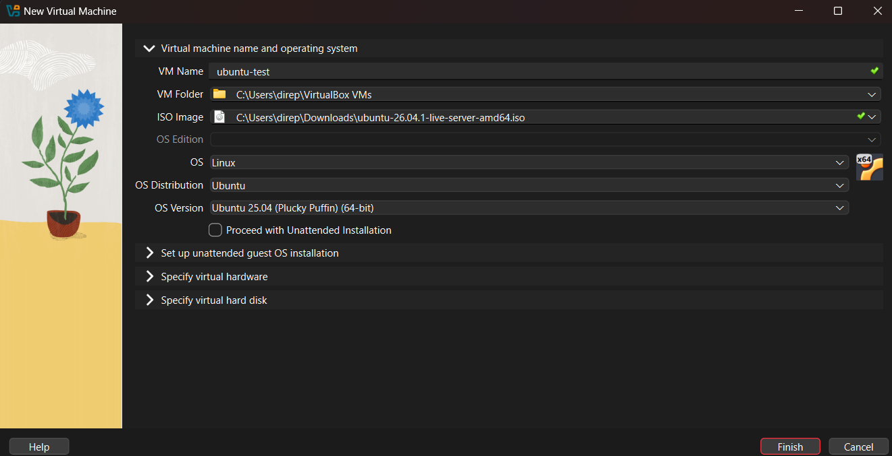
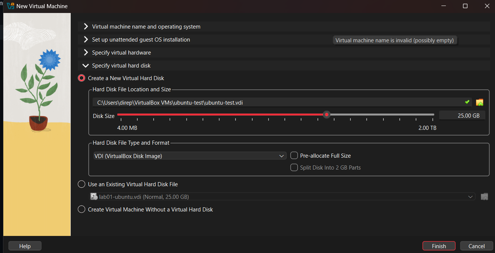
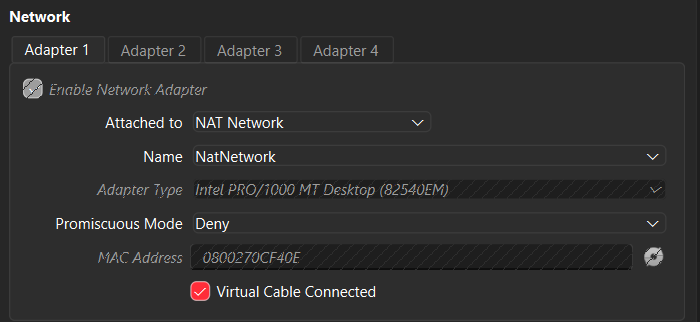
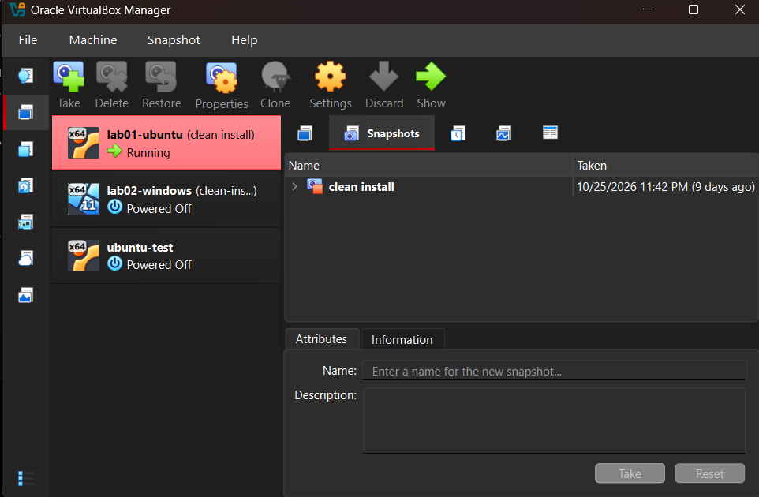

# How to Build the Developer Test Environment

This guide walks you through setting up two isolated test computers (one Ubuntu Linux server and one Windows 11 desktop) inside your Windows laptop. Everything the developer does stays inside these virtual machines so the physical laptop cannot be broken, and you can reset either machine to brand-new condition in ten seconds.

---

## Part 1: Install VirtualBox and Download the Operating Systems

## Step 1. Install Oracle VirtualBox
Open your web browser, go to https://www.virtualbox.org/wiki/Downloads, click **Windows hosts** to download the installer, run it, and click **Next** / **Yes** / **Install** through all default prompts without downloading the separate "Extension Pack" on the website.

Why this option and not another: The base VirtualBox application is open-source (GPLv3) and completely free for commercial office use, whereas the optional Extension Pack requires a paid enterprise license that could fail a software audit.

> Check: Open the Windows Start menu, type `VirtualBox`, and open **Oracle VirtualBox** to see the "Oracle VirtualBox Manager" window.

## Step 2. Download the Ubuntu Server ISO image
Go to https://ubuntu.com/download/server, click the green button to download the current **Ubuntu Server LTS** (64-bit / amd64) `.iso` file, and leave it in your **Downloads** folder.

Why this option and not another: Developers build backend systems on Ubuntu Server (which runs without a heavy graphical desktop to save memory), and the LTS (Long Term Support) release is free for commercial use with five years of security updates.

> Check: Open your **Downloads** folder in File Explorer and verify you see a file named `ubuntu-24.04.x-live-server-amd64.iso` (around 2.5 to 3 GB).

## Step 3. Download the Windows 11 Enterprise Evaluation ISO image
Go to https://www.microsoft.com/en-us/evalcenter/download-windows-11-enterprise, fill in the short download form, select **ISO - Enterprise**, choose **64-bit** and **English (United States)**, and save the `.iso` file in your **Downloads** folder.

Why this option and not another: Microsoft's official 90-day Evaluation image is free and legal for workplace testing without buying a Windows license key or risking pirated software.

> Check: Look in your **Downloads** folder and confirm you see a second `.iso` file (around 5 to 6 GB) alongside your Ubuntu file.

---

## Part 2: Create the Shared Test Network

## Step 4. Create a NAT Network in VirtualBox
In the Oracle VirtualBox Manager window, click **File** in the top menu bar, select **Tools**, click **Network Manager**, switch to the **NAT Networks** tab at the top, and click the **Create** button once.

Why this option and not another: VirtualBox's default "NAT" mode isolates each virtual machine behind a separate router so they cannot talk to each other, and office Wi-Fi drops "Bridged" virtual machines with unknown network addresses. A **NAT Network** puts both test machines on the same private network while letting them share the laptop's internet connection.

> Check: Verify that a row named `NatNetwork` with IPv4 Prefix `10.0.2.0/24` appears in the list, then click **Close** on the Network Manager panel (or click the **Machine** menu to return to the main view).

---

## Part 3: Create and Install the Linux Test Machine (Ubuntu Server)

## Step 5. Start the New Virtual Machine Wizard for Ubuntu
Click **Machine** in the top menu bar and select **New**, then type `ubuntu-test` into the **Name** box, click the **ISO Image** dropdown arrow to select your downloaded Ubuntu Server `.iso` file from **Downloads**, tick the checkbox labeled **Skip Unattended Installation**, and click **Next**.

Why this option and not another: Ticking **Skip Unattended Installation** disables VirtualBox's automated installer, which otherwise hides the setup screens and fails to install the OpenSSH remote-access server the developer needs.

> Check: Before clicking **Next**, confirm that **Type** says `Linux`, **Version** says `Ubuntu (64-bit)`, and **Skip Unattended Installation** has a checkmark.

## Step 6. Allocate Memory and CPU Cores for Ubuntu
Type `4096` MB into the **Base Memory** box, set **Processors** to `2`, and click **Next**.

Why this option and not another: This laptop has 16 GB of RAM and 24 CPU cores (with Windows on the laptop using about 6 GB at rest). Giving Ubuntu 4 GB of RAM and 2 cores leaves 10 GB of RAM and 22 cores available so the Windows test machine and the main laptop never slow down.

> Check: Confirm the memory box reads `4096 MB`, the processor box reads `2`, and both sliders are in the green safety zone.

## Step 7. Create a Dynamically Allocated Virtual Disk for Ubuntu
Leave **Create a Virtual Hard Disk Now** selected, set the disk **Size** to `25.00 GB`, leave the **Pre-allocate Full Size** box unticked, click **Next**, and click **Finish**.

Why this option and not another: Leaving **Pre-allocate Full Size** unticked creates a thin (dynamically allocated) virtual disk file that takes up almost no space on your laptop today and only grows as the developer adds files, up to 25 GB.

> Check: Look at the left sidebar of VirtualBox and confirm `ubuntu-test` is listed as **Powered Off**.

## Step 8. Attach Ubuntu to the Shared NAT Network
Click `ubuntu-test` in the left list, click the yellow **Settings** gear icon at the top, click **Network** in the left menu, change the **Attached to:** dropdown from `NAT` to **NAT Network**, ensure the **Name** box below it says `NatNetwork`, and click **OK**.

Why this option and not another: Attaching the adapter to `NatNetwork` connects the Ubuntu server to the shared virtual switch you created in Step 4 so it can communicate with the Windows machine.

> Check: In the main VirtualBox window under the **Network** heading for `ubuntu-test`, verify it now reads `Adapter 1: Intel PRO/1000 MT Desktop (NAT Network)`.

## Step 9. Boot the Ubuntu Installer and Set Language and Network Defaults
Select `ubuntu-test`, click the green **Start** arrow at the top, click inside the black virtual machine window to type into it (press the **Right Ctrl** key on your keyboard whenever you want to release your mouse cursor back to your laptop), and use the **Up/Down Arrow keys** and **Enter** key to complete the first screens:
1. Highlight **Try or Install Ubuntu Server** and press **Enter** (wait 1–2 minutes for the installer menu to load).
2. Highlight **English** and press **Enter**.
3. If a screen offers an installer update, leave **Continue without updating** highlighted and press **Enter**.
4. On the Keyboard configuration screen (`English (US)`), press **Enter** on **[ Done ]**.
5. On the Type of install screen, leave **Ubuntu Server** selected and press **Enter** on **[ Done ]**.
6. On the Network connections screen, wait until the line under `enp0s3` shows an address like `10.0.2.x/24`, then press **Enter** on **[ Done ]**.
7. On the Configure proxy screen, leave it blank and press **Enter** on **[ Done ]**.
8. On the Configure Ubuntu archive mirror screen, wait for `Mirror location passed tests` to appear, then press **Enter** on **[ Done ]**.

Why this option and not another: Selecting the standard **Ubuntu Server** option (instead of minimized) installs the essential command-line diagnostic tools a developer expects, and accepting automatic network configuration (DHCP) gives the server an IP address on your `NatNetwork` automatically.

> Check: You should now be looking at the **Guided storage configuration** screen with `[X] Use an entire disk` selected.

## Step 10. Partition the Virtual Disk and Create the User Profile and SSH Server
Continue using the **Arrow keys**, **Spacebar**, and **Enter** key on the remaining installer screens:
1. On the Guided storage configuration screen, leave **Use an entire disk** checked, use the **Down Arrow** to highlight **[ Done ]**, and press **Enter**.
2. On the Storage configuration summary screen, press **Enter** on **[ Done ]**, then use the **Down Arrow** in the red confirmation pop-up to select **[ Continue ]** and press **Enter**.
3. On the Profile configuration screen, type `dev` for **Your name**, `ubuntu-test` for **Your server's name**, `dev` for **Pick a username**, and a simple password in both password boxes (write this password on a piece of paper), then arrow down to **[ Done ]** and press **Enter**.
4. On the Upgrade to Ubuntu Pro screen, leave **Skip for now** selected and press **Enter** on **[ Continue ]**.
5. On the **SSH Setup** screen, press the **Spacebar** on `[ ] Install OpenSSH server` so it changes to `[X] Install OpenSSH server`, then arrow down to **[ Done ]** and press **Enter**.
6. On the Featured Server Snaps screen, do not select any boxes; arrow down to **[ Done ]** and press **Enter**.
7. Wait 5 to 10 minutes until the orange banner at the top says **Installation complete!**, then use the **Down Arrow** to highlight **[ Reboot Now ]** and press **Enter**.
8. When the black screen says `Please remove the installation medium, then press ENTER:`, simply press **Enter**.

Why this option and not another: Selecting **Use an entire disk** only formats the isolated 25 GB virtual file you created in Step 7 (your real laptop drive cannot be touched by the VM), and checking **Install OpenSSH server** allows remote terminal connections into the server.

> Check: Wait 1 minute after rebooting, press **Enter** once to clear the startup log text, and verify you see `ubuntu-test login:`.

## Step 11. Log In to Ubuntu Server and Verify the Installation
At the `ubuntu-test login:` prompt, type `dev` and press **Enter**, type your password and press **Enter** (no stars or letters will appear on screen while you type the password—that is a normal Linux security feature), and then run these two commands by typing each line and pressing **Enter**:

    uname -a
    lsb_release -a

Why this option and not another: Ubuntu Server intentionally has no graphical desktop so that all memory goes to the developer's software; running `uname -a` and `lsb_release -a` confirms the Linux kernel and Ubuntu LTS operating system are installed properly.

> Check: The screen prints a line starting with `Linux ubuntu-test` followed by `Description: Ubuntu 24.04.x LTS` (matching the text saved in evidence/04-guest-uname.txt). Leave this Ubuntu window running in the background for Part 5.

---

## Part 4: Create and Install the Windows 11 Test Machine

## Step 12. Start the New Virtual Machine Wizard for Windows 11
Switch back to the main **Oracle VirtualBox Manager** window, click **Machine** -> **New**, type `windows-test` in the **Name** box, select your downloaded Windows 11 Enterprise `.iso` file in the **ISO Image** dropdown, tick **Skip Unattended Installation**, and click **Next**.

Why this option and not another: Selecting the Windows 11 `.iso` sets the VM version to `Windows 11 (64-bit)`, which automatically switches on the virtual hardware security requirements (UEFI, Secure Boot, and virtual TPM 2.0) that Windows 11 demands. Ticking **Skip Unattended Installation** lets you choose a local account instead of getting stuck in an automated setup script.

> Check: Confirm **Type** is `Microsoft Windows`, **Version** is `Windows 11 (64-bit)`, and **Skip Unattended Installation** is ticked before clicking **Next**.

## Step 13. Allocate Memory, CPU Cores, and Thin Disk for Windows 11
Set **Base Memory** to `4096` MB and **Processors** to `4`, click **Next**, leave **Create a Virtual Hard Disk Now** selected, set the disk **Size** to `65.00 GB`, leave **Pre-allocate Full Size** unticked, click **Next**, and click **Finish**.

Why this option and not another: Windows 11 requires at least 4 GB of RAM and 64 GB of storage to install. Giving it 4 GB of RAM (alongside Ubuntu's 4 GB and the host laptop's 6 GB idle usage) uses 14 GB of your 16 GB total RAM, leaving 2 GB of safe headroom, while 4 of your 24 CPU cores keep the graphical desktop smooth.

> Check: Click `windows-test` in the left sidebar and check under the **System** section that `Base Memory: 4096 MB`, `Processors: 4`, `EFI: Enabled`, and `TPM: v2.0` are all shown.

## Step 14. Attach Windows 11 to the Shared NAT Network
With `windows-test` selected in the left sidebar, click **Settings** (yellow gear), click **Network** on the left, change **Attached to:** from `NAT` to **NAT Network**, confirm **Name** says `NatNetwork`, and click **OK**.

Why this option and not another: Putting `windows-test` on the exact same `NatNetwork` as `ubuntu-test` connects both machines to the same virtual router so they can reach each other and the internet.

> Check: Under the **Network** section of `windows-test` in the main window, verify it says `Adapter 1: Intel PRO/1000 MT Desktop (NAT Network)`.

## Step 15. Boot the Windows 11 Installer and Start Copying Files
Select `windows-test`, click the green **Start** arrow, and follow these exact actions:
1. Immediately click inside the new black VM window and tap the **Spacebar** as soon as you see `Press any key to boot from CD or DVD...` (if you miss it and see an `UEFI Interactive Shell` screen, click **Machine** -> **Reset** at the top of the window and tap Spacebar immediately).
2. On the purple Windows Setup window, click **Next**, then click **Install now**.
3. If asked for a product key, click **I don't have a product key** at the bottom; if asked to choose an operating system edition, select **Windows 11 Enterprise Evaluation** and click **Next**.
4. Tick **I accept the Microsoft Software License Terms** and click **Next**.
5. Click the second box labeled **Custom: Install Windows only (advanced)**.
6. Click `Drive 0 Unallocated Space (65.0 GB)` and click **Next**.
7. Wait 15 to 20 minutes while Windows installs and restarts several times on its own—**do not** press any key when `Press any key to boot from CD or DVD...` appears during these restarts.

Why this option and not another: Choosing **Custom: Install Windows only** tells Windows to format the fresh 65 GB virtual disk, and ignoring the CD boot prompt during restarts allows the VM to boot from the newly installed virtual hard disk instead of starting the installer over from scratch.

> Check: After the restarts finish, you will see the blue Windows 11 setup screen asking `Is this the right country or region?`.

## Step 16. Complete Windows 11 Setup with a Local Account
On the blue Windows 11 setup screens, complete the user setup:
1. Select **United States** (or your country) and click **Yes**, select **US** keyboard and click **Yes**, and click **Skip** on the second keyboard screen.
2. Wait for the update check to finish, and if asked to name the device, click **Skip for now**.
3. On the **Sign in** screen, do **not** type an email address; instead, click **Sign-in options** and then click **Domain join instead**.
4. Type `dev` in the **Enter your name** box and click **Next**, type a simple password twice (write it on paper), and select and answer the three security questions with any single word (such as `test`).
5. On the **Choose privacy settings for your device** screen, switch every toggle to **Off** and click **Accept**.

Why this option and not another: Clicking **Domain join instead** creates a standalone local account on the test machine so you never have to link a personal or company Microsoft email account to a temporary test environment.

> Check: After a few minutes of "Getting things ready", the Windows 11 desktop and taskbar appear on screen.

## Step 17. Install VirtualBox Guest Additions in Windows 11
At the top menu bar of the `windows-test` window, click **Devices** -> **Insert Guest Additions CD image...**, then click the yellow **File Explorer** folder icon on the Windows taskbar, click **This PC** on the left, double-click **CD Drive (D:) VirtualBox Guest Additions**, double-click **VBoxWindowsAdditions.exe** (click **Yes** on the permission pop-up), click **Next** -> **Next** -> **Install**, and select **Reboot now** -> **Finish**.

Why this option and not another: Installing **Guest Additions** adds display and clipboard drivers so the Windows screen resizes cleanly and you can copy and paste commands between your physical laptop and the test machine.

> Check: Once Windows restarts and you log in with your password, drag the corner of the VirtualBox window—the Windows 11 desktop automatically expands to fit the window.

---

## Part 5: Configure the Firewall and Verify Network Connectivity

## Step 18. Add an Inbound Ping Rule to Windows Defender Firewall
Inside the `windows-test` desktop, right-click the blue **Start** button on the taskbar, click **Terminal (Admin)** (or **PowerShell (Admin)**), click **Yes** on the prompt, and type (or paste) this exact command on one line, then press **Enter**:

    New-NetFirewallRule -DisplayName "Allow ping in (ICMPv4)" -Protocol ICMPv4 -IcmpType 8 -Direction Inbound -Action Allow

Why this option and not another: Windows treats a new virtual network as an untrusted "Public" network and blocks incoming ping tests (`ICMPv4 Echo Requests`) by default. Adding this single rule permits ping tests from Ubuntu without turning off the Windows Defender Firewall, which would leave the system completely unprotected.

> Check: The PowerShell window prints a list of properties ending with `Enabled : True`, `Direction : Inbound`, and `Action : Allow`. Keep this PowerShell window open for the next step.

## Step 19. Find the IP Addresses of Both Test Machines
1. In the open Windows PowerShell window, type `ipconfig` and press **Enter**, then look under `Ethernet adapter Ethernet` for the line labeled **IPv4 Address** and write down that number (for example, `10.0.2.15`).
2. Switch to your running `ubuntu-test` window, type `ip -br a` and press **Enter**, then look at the line starting with `enp0s3` and write down the IP address before the `/24` (for example, `10.0.2.4`).

Why this option and not another: Every virtual machine on `NatNetwork` receives its own unique address starting with `10.0.2.x`; checking both addresses confirms neither machine is stuck with an identical address.

> Check: Both addresses start with the same first three numbers (such as `10.0.2.`) and end with two **different** final numbers (for example, `.4` for Ubuntu and `.15` for Windows).

## Step 20. Test Two-Way Network Communication and Internet Access
1. Inside the `ubuntu-test` window, type these two commands (replace `10.0.2.15` with the Windows IPv4 Address you wrote down in Step 19) and press **Enter** after each:

    ping -c 4 10.0.2.15
    ping -c 4 ubuntu.com

2. Inside the `windows-test` PowerShell window, type these two commands (replace `10.0.2.4` with the Ubuntu IP address you wrote down in Step 19) and press **Enter** after each:

    ping 10.0.2.4
    ping ubuntu.com

Why this option and not another: Pinging from Linux to Windows, Windows to Linux, and both machines out to `ubuntu.com` proves the developer can test client-server software between the two machines and download software packages from the internet.

> Check: In Ubuntu, both commands finish with `4 packets transmitted, 4 received, 0% packet loss`. In Windows, both commands finish with `Packets: Sent = 4, Received = 4, Lost = 0 (0% loss)`, matching the log in evidence/05-ping-between-guests.txt.

---

## Part 6: Take Clean Snapshots and How to Roll Back Damage

## Step 21. Power Off Both Machines and Take the `clean-install` Snapshots
1. In the `ubuntu-test` window, type `sudo poweroff`, press **Enter**, and type your password if asked so the server shuts down completely.
2. In the `windows-test` window, click the **Start** button -> **Power** icon -> **Shut down** and wait for the window to close.
3. In the **Oracle VirtualBox Manager** window, hover over `ubuntu-test` in the left list, click the **three-line menu icon** next to its name, and select **Snapshots**.
4. Click the **Take** (camera) icon at the top, type `clean-install` in the **Snapshot Name** box, type `Fresh Ubuntu Server install with network verified` in the **Snapshot Description** box, and click **OK**.
5. Click `windows-test` in the left list, click its **three-line menu icon** -> **Snapshots**, click **Take**, type `clean-install` in the **Snapshot Name** box, and click **OK**.

Why this option and not another: Taking a snapshot while both virtual machines are powered off creates a small, clean restore point before the developer installs or breaks anything.

> Check: In the **Snapshots** view for both `ubuntu-test` and `windows-test`, confirm `clean-install` appears directly above `Current State`.

## Step 22. How to Roll Back Whenever a Machine Gets Broken
Whenever the developer breaks one of the machines (or leaves for another project and you want to reset the machine for the next starter), perform this 10-second rollback:
1. Make sure the broken virtual machine is powered off (if it is running, click **Machine** -> **Close** -> select **Power off the machine** -> click **OK**).
2. In the main VirtualBox window, click the machine's **three-line menu icon** -> **Snapshots**, click `clean-install` in the list, and click the **Restore** icon at the top.
3. In the confirmation pop-up box, **untick** the checkbox labeled `Create a snapshot of the current machine state` and click **Restore**.

Why this option and not another: Unticking `Create a snapshot of the current machine state` discards the broken files instead of saving a backup of the damage, instantly returning the virtual machine to the exact clean state from Step 21.

> Check: Click the green **Start** arrow to boot the machine—any deleted system files, broken network configs, or test programs are completely gone.

---

## Part 7: What to Do When Something Typical Goes Wrong

| What you see | Why it happened | How to fix it |
| :--- | :--- | :--- |
| **"VT-x is disabled in the BIOS" or "AMD-V is not available"** | Hardware virtualization is turned off in the laptop's motherboard settings. | Restart the physical laptop, press **F2**, **F10**, or **Del** repeatedly during startup to enter UEFI/BIOS settings, change **Intel Virtualization Technology (VT-x)** or **AMD-V (SVM Mode)** to **Enabled**, save, and restart. |
| **Mouse cursor is trapped inside the black VM window** | VirtualBox captured the mouse so you can click inside the guest operating system. | Press the **Right Ctrl** key on your keyboard once (the "Host Key" shown at the bottom-right corner of the VM window) to release the mouse back to your laptop. |
| **"Fatal: No bootable medium found!"** | The `.iso` installer file was detached or not selected during wizard setup. | Shut down the VM, open its **Settings** -> **Storage**, click **Empty** under `Controller: IDE`, click the small blue disc icon on the far right, click **Choose a disk file...**, select your `.iso` in **Downloads**, and click **OK**. |
| **"This PC can't run Windows 11"** | EFI firmware, Secure Boot, TPM 2.0, or minimum RAM/CPU were not enabled. | Power off `windows-test`, open **Settings** -> **System**, ensure **Base Memory** is `4096 MB`, **Enable EFI** is ticked, **TPM Version** is `v2.0`, and under the **Processor** tab **Processors** is at least `2` (or `4`). |
| **Windows boots into a black `Shell>` prompt instead of the purple installer** | You did not press a key quickly enough when `Press any key to boot from CD or DVD...` appeared. | Click **Machine** -> **Reset** at the top of the VM window, immediately click inside the black screen, and tap the **Spacebar** repeatedly until the logo appears. |
| **Both VMs show the exact same IP address (`10.0.2.15`) and cannot ping each other** | One or both VMs were left on default `NAT` instead of `NAT Network`. | Open **Settings** -> **Network** on both VMs, change **Attached to:** to **NAT Network** (`NatNetwork`), click **OK**, and run `sudo reboot` in Ubuntu so it requests a fresh IP address. |
| **Windows can ping Ubuntu, but Ubuntu to Windows says `100% packet loss`** | Windows Defender Firewall is blocking incoming ICMPv4 echo requests on the Public network profile. | Open **PowerShell (Admin)** inside Windows 11 and run the `New-NetFirewallRule` command from **Step 18**. Never turn the Windows Firewall off completely. |
| **Using SSH from the physical laptop into Ubuntu says `Connection timed out`** | VirtualBox `NAT Network` hides the guests behind a virtual router so the host laptop cannot dial their `10.0.2.x` IP directly. | Open **File** -> **Tools** -> **Network Manager** -> **NAT Networks** -> select `NatNetwork` -> **Port Forwarding** tab -> add an IPv4 rule with **Host Port** `2222`, **Guest IP** set to Ubuntu's IP (e.g., `10.0.2.4`), and **Guest Port** `22`, click **Apply**, then connect from Windows PowerShell on your laptop using `ssh -p 2222 dev@127.0.0.1`. |